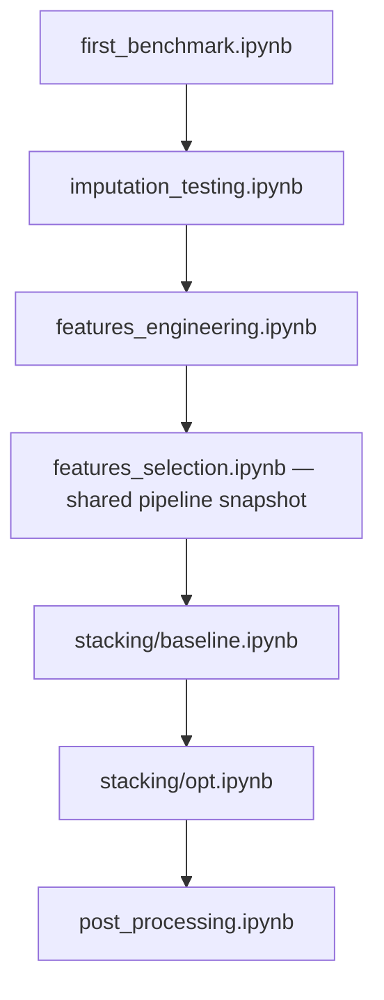

# Repository guide

This project predicts the corrected motor OFF score for each patient visit in the Parkinson challenge. The selected approach combines patient-history imputation, engineered features, a bidirectional Transformer encoder and HistGB regression.

See [README.md](README.md) for the experimental reasoning and results. This guide describes the repository and the notebooks to read.

## Repository contents

| Path | Contents |
|---|---|
| [exploration/](exploration/) | Data analysis, pipeline development, model comparisons and validation. |
| [figures/](figures/) | Architecture diagrams and figures from the experiments. |
| `data/` | Local training/test tables, submission files and saved validation predictions. CSV files are ignored by Git. |
| `model/` | Currently empty. |
| [transformer details.md](transformer%20details.md) | Notes on encoder training, epoch selection and validation seeds. |
| [research_two_approaches.md](research_two_approaches.md) | Proposed follow-up research on patient trajectories and measurement modeling. |

`.venv/` contains the local Python environment.

## Exploration folder

**Key notebooks used to build the final pipeline:**

The arrows show the development order. They are a reading guide; running the selected model does not require rerunning every earlier experiment.

| Order | Notebook | Pipeline version or contribution |
|---|---|---|
| 1 | [first_benchmark.ipynb](exploration/first_benchmark.ipynb) | Initial preprocessing and regression-model comparison, establishing the HistGB baseline. |
| 2 | [imputation_testing.ipynb](exploration/imputation_testing.ipynb) | Compares imputation strategies and establishes `multivariate_4_history`, using the patient's other visits. |
| 3 | [features_engineering.ipynb](exploration/features_engineering.ipynb) | Adds the selected `all_groups` visit/history features after imputation and tunes HistGB. |
| 4 | [features_selection.ipynb](exploration/features_selection.ipynb) | Stores the complete preprocessing and HistGB pipeline reused by stacking. Its feature-selection experiments are not retained in the selected pipeline. |
| 5 | [stacking/baseline.ipynb](exploration/stacking/baseline.ipynb) | Adds frozen per-visit Transformer embeddings to the engineered features before HistGB. |
| 6 | [stacking/opt.ipynb](exploration/stacking/opt.ipynb) | Optimizes encoder architecture, confirms the best configurations, then tunes HistGB on the winning encoder embeddings. Includes final-training and submission code. |
| 7 | [post_processing.ipynb](exploration/post_processing.ipynb) | Evaluates the selected pipeline, tunes monotone smoothing, plots patient trajectories and exports final test predictions. |

### Other exploration notebooks

| Notebook | Purpose |
|---|---|
| [dataset_exploration.ipynb](exploration/dataset_exploration.ipynb) | Examines the data, missingness, ON/OFF measurements and time since medication intake. |
| [outlier_study.ipynb](exploration/outlier_study.ipynb) | Studies unusual observations, residuals and possible outlier treatments. |
| [stacking/engineered.ipynb](exploration/stacking/engineered.ipynb) | Tests adding engineered visit-history features to the encoder inputs. |
| [stacking/prediction_oof.ipynb](exploration/stacking/prediction_oof.ipynb) | Tests patient-separated out-of-fold encoder predictions as HistGB inputs instead of embeddings. |
| [stacking/ridge_opt.ipynb](exploration/stacking/ridge_opt.ipynb) | Compares scaled Ridge and Elastic Net in place of the final HistGB. Small Optuna searches reuse cached encoder features; Elastic Net tunes `alpha` and `l1_ratio`. |

### Shared code and execution

Stacking notebooks execute five setup cells from `features_selection.ipynb` to reuse preprocessing and the baseline pipeline. `post_processing.ipynb` loads setup and encoder definitions from `stacking/cosine_annealing.ipynb`. Keep these dependencies available when moving notebooks.

Validation separates patients between training and validation. Encoder fits include an internal patient holdout to select the epoch count, followed by a fresh fit on all patients in the training split. Hyperparameter-search scores guide selection and are not independent test scores.

The training cell in `post_processing.ipynb` refits the pipeline across five splits. Once it has saved `data/post_processing_validation_predictions.csv`, its plotting cell can run independently without retraining.
